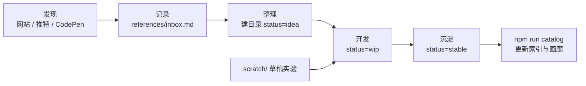

# 收录流程



## 1. 发现 → 记录

看到好的效果，但暂时没空实现：
- 把链接 + 一句话描述追加到 [references/inbox.md](../references/inbox.md)。
- 截图 / 录屏放到 `references/inspirations/`，文件名 `YYYYMMDD-<关键词>.png`。

## 2. 整理（idea）

决定要收录时：
```bash
npm run new -- <category> <slug> --title "中文名"
```
- `meta.json` 中 `status: "idea"`、`source.type: "reference"`，填写 `source.url`。
- README 写清楚效果描述，此时可以没有实现代码。
- 从 `inbox.md` 中把对应条目标记为已整理（`- [x]`）。

## 3. 开发（wip）

- 想快速试验可以先在根目录的 `scratch/` 里写（按需创建；整个目录被 git 忽略，仅本地保留、没有备份），成型后迁移到组件目录。
- 优先写 `vanilla/`（Web Component）实现——它能直接被 `demo.html` 使用；再按需补 `react/` 等。
- 改编外部代码时：`source.type: "adapted"`，必须保留原作者与许可证。

## 4. 沉淀（stable）

满足 [AGENTS.md](../AGENTS.md) 中的「完成标准」后，把 `status` 改为 `stable`，运行：
```bash
npm run catalog
```

## 5. 片段（snippets）

如果只是一个小技巧（一段 CSS、一个 hook、一个工具函数，通常 < 50 行、不需要演示页），放到 `snippets/` 即可，不需要走组件流程。
